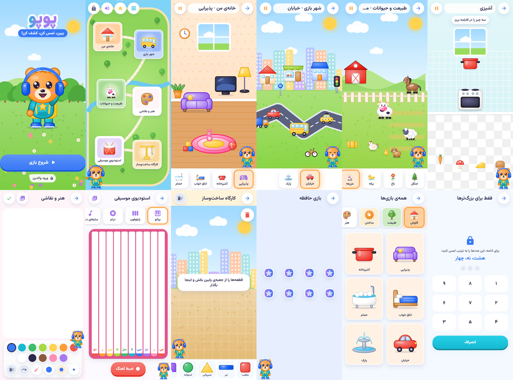

# پوپو — ببین، لمس کن، کشف کن! (Flutter)

بازی ساختن و کشف برای کودکان ۲ تا ۸ سال، با رابط فارسی و راست‌چین. طوفان همه‌چیزِ **جشن بزرگ جنگل** را به هم
ریخته و پوپو، روباه دختر کوچولو با پاپیون صورتی، با کمک کودک در **۸ فصل و ۳۲ بخش** همه‌چیز را از نو
می‌سازد: آب‌پرتقال و نان و کیک، آب‌پاش و گلدان، چکش و چراغ‌قوه و ماشین، رنگ و فانوس، چادر و تلسکوپ، طبل و
زایلوفون، پل و اتوبوس… هر چیز ساخته‌شده **امتحان** می‌شود (مزه‌اش چشیده، کارش دیده، موتورش روشن، صدایش
شنیده می‌شود)، کودک می‌گوید **به چه درد می‌خورد**، با آن **بازی** می‌کند و در **کوله‌پشتی** می‌ماند تا در
فصل‌های بعد به کار بیاید.

سند کامل سناریو: «سناریوی تازه‌ی پوپو — طراحی کامل بازی» (Claude Docs).



*تصویرها از نسخه‌ی وب همین کد در Chromium (۴۱۲×۸۷۰): خانه، نقشه‌ی فصل، مأموریت، چیدن، جدا کردن،
کوله‌پشتی، کارگاه ستاره، فروشگاه ابزار، اتاق بازی، فیلم پایان فصل. چیزهایی که هنوز تصویر رستری ندارند با شکلک
نشان داده می‌شوند (پایین‌تر: تصویرها).*

این پروژه از الگوی [goshyar_game](https://github.com/mojtaba-pourasghar/goshyar_game) پیروی می‌کند
(سیستم طراحی، لایه‌ی دارایی‌ها و CDN، جمله‌های گوینده در JSON، استودیوی صداگذاری، Cloudflare R2) و
نام، نشان، شخصیت و تصویرهایش همه اصلی‌اند؛ هیچ دارایی‌ای از Pok Pok یا برند دیگری استفاده نشده است.

## اجرا

نیازمندی‌ها: Flutter 3.47 یا بالاتر (Dart 3.13)، برای اندروید Android SDK و JDK 17، برای iOS Xcode.

```bash
flutter pub get
flutter run                     # گوشی یا شبیه‌ساز
flutter run -d chrome           # پیش‌نمایش سریع در مرورگر
```

## ساخت خروجی

```bash
flutter build apk --release                 # build/app/outputs/flutter-apk/app-release.apk
flutter build appbundle --release           # Google Play / کافه‌بازار / مایکت
flutter build ios --release                 # روی macOS
flutter build web --release

# با سرور دارایی‌های Cloudflare (اختیاری؛ cloudflare/README.md)
flutter build apk --release \
  --dart-define=POPO_CDN_BASE=https://assets.example.com \
  --dart-define=POPO_ASSET_VERSION=v1
```

**امضا:** `android/key.properties.example` را به `android/key.properties` کپی و پر کنید. بدون آن، نسخه‌ی
release با کلید debug امضا می‌شود که فقط برای آزمایش است. شناسه‌ی بسته: `com.pokpok.ir`.

## آزمون‌ها

```bash
flutter analyze
flutter test                                   # ۱۲۲ آزمون، بدون دستگاه
flutter test integration_test -d <device>      # همان جریان روی دستگاه واقعی
```

| فایل | چه چیزی |
|---|---|
| `test/game_logic_test.dart` | قاعده‌ی ستاره (راهنما، اشتباه، زمان، سن)، سکه (بار اول، تکرار، رکورد)، مرتبه، بهترین نتیجه می‌ماند، خرید ابزار، جایزه‌ی روزانه و هفت‌روزه، سفارش و ترکیب و جای پنهان، جدایی نمایه‌ها |
| `test/content_integrity_test.dart` | ۸ فصل × ۴ بخش؛ هر گام موتور شناخته‌شده و تصویر و صدای واقعی دارد؛ **کوله‌پشتی فقط چیزی را می‌خواهد که قبلاً در داستان ساخته شده**؛ کیت‌ها و ابزارها و ترکیب‌ها و سفارش‌ها؛ هر جمله‌ی پوپو موجود است؛ checksum دارایی‌ها؛ مجوز صداها |
| `test/app_flow_test.dart` | شروع ← معرفی ← خانه؛ جایزه‌ی روز؛ قفل فصل‌ها؛ **یک بخش کامل**: گام ← ساخته شد ← امتحان (مزه) ← سؤال ← بازی ← کوله و ستاره؛ مانع کوله‌پشتی: وسیله‌ی غلط کاربردش را می‌گوید، درست حل می‌کند؛ دروازه‌ی والدین؛ تنظیمات صدا؛ نمایه‌ها؛ متن درشت؛ زیرنویس |
| `test/paywall_flow_test.dart` | فصل ۱ کامل و بخش اول هر فصل رایگان؛ بخش پولی برگه‌ی خرید را باز می‌کند؛ بعد از خرید همه باز |
| `test/routes_smoke_test.dart` | ۱۸ مسیر × ۳ اندازه: بدون خطا، بدون سرریز، و **هر دکمه‌ی دیده‌شده واقعاً لمس‌پذیر** |
| `test/storage_test.dart`، `download_manager_test.dart`، `notice*_test.dart`، `access_store_test.dart` | ذخیره و انتقال داده، دانلود و checksum، خبرهای امضاشده، پرداخت |

## ساختار

```
lib/
  main.dart                    راه‌اندازی Hive، محتوا، داستان (game.json)، دارایی‌ها، صدا
  app/                         router.dart (GoRouter + مسیرهای محافظت‌شده)، providers.dart (Riverpod)، theme/
  game/
    game_data.dart             فصل، بخش، گام، شیء ساخته‌شده، کیت، ابزار، ترکیب، سفارش (از game.json)
    game_state.dart            پیشرفت هر کودک: ستاره (خرج نمی‌شود)، سکه (خرج می‌شود)، کوله‌پشتی، ابزارها …
    scoring.dart               قاعده‌ی ستاره و سکه و مرتبه‌ی سازنده
    engines/                   ۱۹ موتور مینی‌بازی + EngineHost (درست/اشتباه/پله‌های راهنما)
  ui/clay.dart                 سیستم طراحی هم‌خانواده‌ی گوش‌یار: Pressable، ClayButton، کارت، آسمان و تپه‌ها، GameArt
  features/
    home/                      خانه با چهار زبانه (ماجرا، کارگاه، اتاق بازی، من) و قفل‌ها (Gate)
    chapter/                   نقشه‌ی فصل و فیلم پایان فصل
    play/                      صفحه‌ی بخش (مأموریت ← گام‌ها ← امتحان و کشف ← سؤال ← بازی ← ستاره) و نمایش هر نوع شیء
    workshop/                  کارگاه ستاره (کیت‌ها) و فروشگاه ابزار
    playroom/                  اتاق بازی: قفسه، صحنه، ترکیب‌ها، سفارش‌های روز
    mascot/ onboarding/ profiles/ settings/ parental_dashboard/ downloads/ notices/ paywall/
  core/                        دارایی‌ها و CDN، صدا (چهار کانال)، ذخیره، پرداخت بازار، خبرها، ابزارک‌های قدیمی
assets/
  content/game.json            کل داستان (ساخته‌ی tools/content/build_game.py)
  content/voice_lines.json     همه‌ی جمله‌های پوپو (استودیو همین را می‌خواند)
  art/character/               ۸ حالت پوپو؛ art/characters/ هفت دوست؛ art/backgrounds/ صحنه‌ها؛ art/items/ اشیا
  audio/                       ui، sfx، animals، ambient، instruments، music، voice
tools/
  content/build_game.py        داستان، گام‌ها، اشیا، کیت‌ها، ابزارها، جمله‌ها و prompt تصویرها در یک جا
  art/prompts.py + generate_cf.py   ساخت تصویرها با Cloudflare
  voice-studio/                استودیوی صداگذاری (جمله‌ها بر اساس فصل گروه‌بندی شده‌اند) و خبرها
```

## افزودن محتوا بدون تغییر کد

همه‌چیز در `tools/content/build_game.py` است. یک بخش تازه یعنی یک `section(...)` با فهرست گام‌ها؛ هر گام یکی از
موتورهاست: `collect` (چیدن)، `sort` (جدا کردن)، `cut` (بریدن)، `tap` (فشار، ورز، میخ زدن)، `rotate` (هم زدن،
کلید، پیچ)، `pour` (ریختن تا خط)، `timing` (وقتی طلایی شد)، `assemble` (سوار کردن تکه‌ها)، `order` (ترتیب و
اندازه)، `count` (شمردن)، `paint` (رنگ زدن)، `mix` (ترکیب رنگ)، `scrub` (شستن)، `dark` (پیدا کردن با نور)،
`trace` (دنبال کردن راه)، `rhythm` (تکرار آهنگ)، `puzzle` (پازل)، `use` (مانعی که فقط با ساخته‌ی قبلی حل می‌شود)،
`serve` (به هر دوست چیزی که می‌خواهد). بعد:

```bash
python3 tools/content/build_game.py   # game.json، جمله‌های تازه در voice_lines.json، prompt تصویرها
python3 tools/art/prompts.py && python3 tools/art/generate_cf.py --steps 4
flutter test                          # آزمون سلامت محتوا ارجاع شکسته یا کوله‌ی ناممکن را پیدا می‌کند
```

## تصویرها با Cloudflare (level 3)

همه‌ی تصویرها (۸ حالت پوپو، ۷ دوست، ۱۲ پس‌زمینه و ۱۶۲ شیء) یک prompt با سبک یکسان رندر سه‌بعدی
(همان سبک گوش‌یار) در `art/art_manifest.json` دارند و با Cloudflare Workers AI (flux-1-schnell، همان مهارت
`.claude/skills/level-3-image-generator`) ساخته می‌شوند:

```bash
cp .env.example .env          # CF_ACCOUNT_ID (۳۲ نویسه) و CF_API_TOKEN؛ .env در گیت نیست
python3 tools/art/generate_cf.py --steps 4           # همه‌ی تصویرهای کم؛ حساب‌ها (CF_ACCOUNT_ID، CF_ACCOUNT_ID_2 …) به نوبت
python3 tools/art/generate_cf.py --kind character    # فقط شخصیت‌ها
```

سهم رایگان روزانه‌ی Cloudflare حدود ۵۵ تصویر است؛ اسکریپت فقط تصویرهای کم را می‌سازد، پس هر روز یک بار اجرا
کافی است. پس‌زمینه‌ی سفید اشیا خودکار برداشته می‌شود و WebP در `assets/art/...` قرار می‌گیرد. تا وقتی تصویر
چیزی ساخته نشده، برنامه شکلک آن را روی دایره نشان می‌دهد. رندرهای خام (`art/generated/`) فقط محلی‌اند.

## صدا

- **صداهای عمومی** (رابط، سازها، ماشین‌ها، آشپزخانه، آب، ساخت‌وساز، دو موسیقی پس‌زمینه): همه با کد ساخته
  شده‌اند (`tools/sfx/synth.py`، numpy + ffmpeg) و اصلی‌اند.
- **صدای واقعی** حیوان‌ها، آب، زنگ در، ساعت، کتری، گیتار/فلوت/ویولن: ضبط‌های Wikimedia Commons (همان
  انتخاب‌های goshyar_game) با منبع، مجوز و پدیدآورنده در `docs/audio/sfx_sources.json`. برای مجوزهای
  CC BY / CC BY-SA ذکر نام پدیدآورنده در صفحه‌ی «درباره» یا فروشگاه لازم است.
- **صدای گوینده (پوپو):** حدود ۵۷۰ جمله در `voice_lines.json` (۴۹۶ جمله‌ی تازه‌ی فصل‌ها، کیت‌ها، فروشگاه و اتاق
  بازی؛ جمله‌های ضبط‌شده‌ی قبلی سر جایشان‌اند)؛ با **استودیوی صداگذاری** `tools/voice-studio`
  (ویندوز: `start.bat`، بقیه: `npm install && npm start`، راهنما: [tools/voice-studio/README.md](tools/voice-studio/README.md))
  صدای موقت با آواشو ساخته می‌شود و ضبط انسانی با `tools/voice/import_recordings.sh` وارد می‌شود.
  تا آن زمان حرف‌های پوپو در حباب زیرنویس نوشته می‌شود و بازی بی‌وقفه کار می‌کند.
- چهار کانال جدا با بلندی و کلید جدا برای هر کودک: موسیقی، جلوه‌ها، صدای محیط، گوینده.

## نسخه‌ی کامل (کافه‌بازار) و خبرها

- **پرداخت:** در release، کل فصل ۱، بخش اول هر فصل و دو کیت اول کارگاه رایگان است و بقیه با یک بار خرید
  «نسخه‌ی کامل» از کافه‌بازار (Poolakey، SKU `popo_full`) باز می‌شوند؛ خرید پشت دروازه‌ی والدین است. در debug
  همه‌چیز باز است. «پنل والدین ← خریدها و بازی‌های دیگر» وضعیت، بازیابی خرید و بازی‌های دیگر ما را دارد.
- **خبرها و اعلان‌ها:** بی هیچ سرویس پوش؛ استودیو خبر را امضا و با FTP روی `mp-apdl.ir/popo/notices.json`
  می‌گذارد و برنامه (باز هر دقیقه، بسته حدود هر ربع ساعت) آن را می‌خواند، امضا را می‌سنجد و خبر را در نوار
  اعلان و در خانه (زنگوله) نشان می‌دهد. خاموش کردن در «پنل والدین ← اعلان‌ها و خبرها».
- راهنمای ساخت release، پنل بازار، کلید RSA و کلید خبرها: [docs/RELEASE.md](docs/RELEASE.md).

## حریم خصوصی و والدین

بدون تبلیغ، بدون ردیاب، بدون حساب کاربری، بدون گفت‌وگو یا نمایه‌ی عمومی. همه‌ی داده‌ها فقط روی دستگاه‌اند.
تنظیمات، نمایه‌ها، تاریخچه، دانلودها، خریدها، خروجی گرفتن از نقاشی و پاک کردن داده‌ها پشت **دروازه‌ی والدین**
(سه عدد به حروف) هستند. این توصیف فنی است، نه تأیید حقوقی؛ پیش از انتشار بررسی حقوقی لازم است.

## وضعیت (صادقانه)

خلاصه در [docs/STATUS.md](docs/STATUS.md). مهم‌ترین‌ها:

- **تصویرها:** پوپو، هفت دوست، همه‌ی پس‌زمینه‌ها و ۲۸ شیء رندر سه‌بعدی شده‌اند؛ بقیه‌ی اشیا در روزهای بعد با
  سهم رایگان Cloudflare ساخته می‌شوند و تا آن زمان شکلک دارند.
- **صدای گوینده:** جمله‌های تازه هنوز صدا ندارند؛ در استودیو (گروه‌های فصل ۱ تا ۸) ساخته می‌شوند. تا آن زمان
  حرف‌های پوپو در حباب نوشته می‌شود.
- **ساخت اندروید/iOS در این محیط اجرا نشد** (Android SDK نبود). نسخه‌ی وب ساخته و در Chromium بررسی شد و همه‌ی
  آزمون‌ها سبزند.
