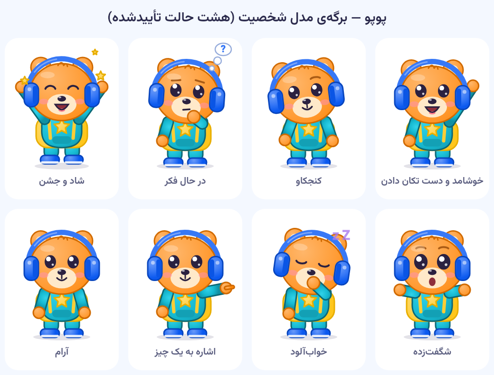
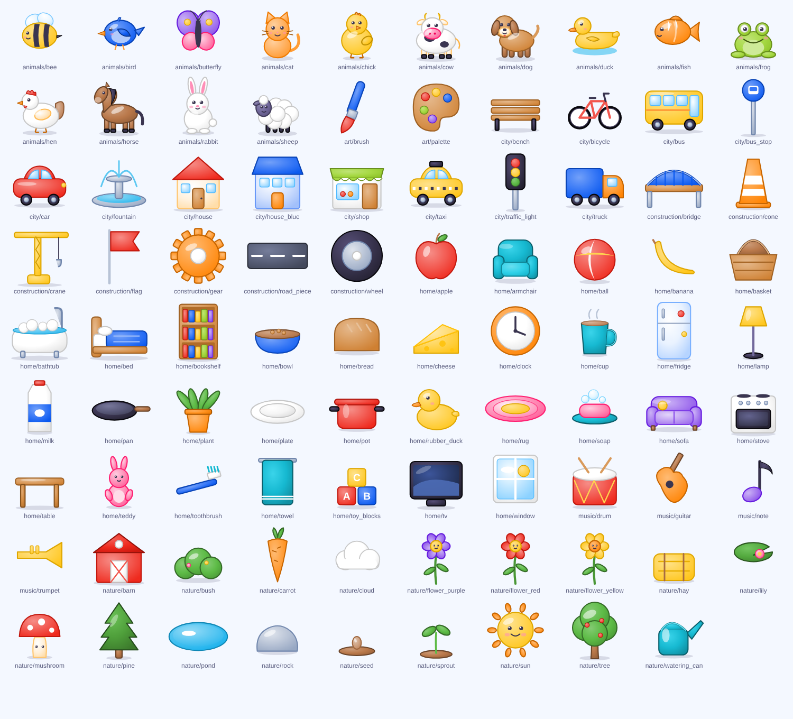

# مشخصات شخصیت، سبک تصویری و دارایی‌ها

## ۱. پوپو — مدل اصلی (تأییدشده)



مدل اصلی **یک نقاش کد** است: `lib/features/mascot/popo_painter.dart`. همه‌ی صفحه‌ها، آیکون برنامه و برگه‌ی
مدل از همین یک فایل کشیده می‌شوند، پس شخصیت هیچ‌جا «بازطراحی» نمی‌شود. هر تصویرساز یا مدل‌ساز سه‌بعدی که
نسخه‌ی نهایی می‌سازد باید با همین برگه منطبق باشد.

| ویژگی | مقدار |
|---|---|
| گونه | خرس کوچولو (نه روباه، نه گربه) |
| خز | نارنجی گرم `#FF9D37`، سایه `#D9741A` |
| پوزه و داخل گوش | کرم `#FFE9C9` |
| چشم | درشت، تیره `#2B2140`، دو نقطه‌ی براق سفید |
| گوش | گرد، بالای سر |
| هدفون | آبی `#3778F6`، بزرگ، روی گوش‌ها با بند روی سر |
| لباس | فیروزه‌ای `#16B9D1` با **ستاره‌ی زرد** `#FFD34F` روی سینه و جیب جلو |
| کوله | زرد کوچک با دو بند |
| کفش | آبی با کف سفید |
| نسبت‌ها | سر ≈ ۴۵٪ قد، بدن کوتاه و گرد؛ بوم مرجع ۲۰۰×۲۶۰ |
| شخصیت | مهربان، کنجکاو، بازیگوش، آرام‌بخش |

**هشت حالت:** خوشامد و دست تکان دادن، کنجکاو، در حال فکر، شاد و جشن، شگفت‌زده، خواب‌آلود، اشاره به یک چیز، آرام.
**حرکت‌ها:** نفس آرام (۳٫۲ ثانیه)، پلک زدن تصادفی (هر ۲ تا ۵ ثانیه)، تکان دادن دست در چند دوره و سپس مکث،
نگاه به جهت دلخواه، واکنش کوتاه (شادی پس از موفقیت، فکر پس از اشتباه). با «حرکت کمتر» پوپو ثابت می‌ماند.

بازسازی برگه‌ی مدل و آیکون‌ها:

```bash
flutter test test/tools/make_model_sheet_test.dart --dart-define=MAKE_DOCS=true
flutter test test/tools/make_icons_test.dart --dart-define=MAKE_ICONS=true
```

## ۲. سبک تصویری



همه‌ی ۸۹ تصویر در `tools/art/build_art.py` با یک دستور کار «خمیری» کشیده می‌شوند:

- گرادیان شعاعی برای هر رنگ (نور از بالا-چپ، تیره‌تر پایین-راست)؛
- دورخط با سایه‌ی تیره‌تر **همان رنگ** (هرگز سیاه)؛
- براقی سفید نیمه‌شفاف روی شکل‌های گرد؛
- سایه‌ی نرم زمین زیر چیزهایی که روی زمین‌اند؛
- گوشه‌های گرد، نسبت‌های کودکانه، چهره‌ی ساده (دو چشم براق، گونه‌ی صورتی، لبخند) برای جانداران.

**پالت:** نارنجی `#FF9D37`، فیروزه‌ای `#16B9D1`، آبی `#3778F6`، سبز `#A6D943`، زرد `#FFD34F`، بنفش
`#A77BEF`، زمینه `#F4F8FF` (نشانه‌های رنگ در `lib/app/theme/tokens.dart`).

**پس‌زمینه‌ها** (`lib/features/worlds/backgrounds/scene_backgrounds.dart`) با همان مختصات نسبی اشیا کشیده
می‌شوند: کف اتاق در y=0.6، افق بیرون در y=0.5؛ جاده‌ی شهر از همان نقطه‌هایی کشیده می‌شود که ماشین روی آن حرکت
می‌کند. به همین دلیل در هر اندازه و جهت صفحه، اشیا روی کف و جاده می‌مانند.

## ۳. فهرست و نام‌گذاری دارایی‌ها

`assets/content/asset_manifest.json` با `python3 tools/build_manifest.py` ساخته می‌شود و برای هر فایل
این‌ها را دارد: `id`، `group`، `path`، `type`، `version`، `bytes`، `sha256`، و برای SVG ابعاد.

| گروه | مسیر |
|---|---|
| حیوان‌ها | `art/animals/` — cow, sheep, chick, hen, rabbit, duck, frog, bird, butterfly, bee, fish, dog, cat, horse |
| طبیعت | `art/nature/` — tree, pine, bush, flower_*, sprout, seed, mushroom, sun, cloud, watering_can, carrot, pond, lily, rock, hay, barn |
| خانه | `art/home/` — sofa, armchair, lamp, table, tv, plant, bookshelf, rug, bed, teddy, ball, toy_blocks, fridge, stove, pot, pan, plate, cup, bathtub, rubber_duck, towel, soap, toothbrush, apple, banana, bread, milk, cheese, basket, bowl, window, clock |
| شهر | `art/city/` — car, bus, truck, taxi, bicycle, house, house_blue, shop, traffic_light, fountain, bench, bus_stop |
| موسیقی/هنر/ساخت | `art/music/`, `art/art/`, `art/construction/` |
| صدا | `audio/ui/`, `audio/sfx/`, `audio/animals/`, `audio/ambient/`, `audio/instruments/`, `audio/music/`, `audio/voice/` |

## ۴. جایگزینی با تصویرسازی نهایی

اگر تصویرسازی سه‌بعدی/رستری نهایی ساخته شد:

1. هر تصویر را با **همان شناسه** ذخیره کنید (`cow.webp`)، پس‌زمینه‌ی شفاف، مربع، ۵۱۲×۵۱۲ (یا ۱۰۲۴ برای تبلت)،
   سوژه وسط و با همان قاب طرح برداری (حدود ۸۰٪ بوم)، نور از بالا-چپ.
2. `python3 cloudflare/scripts/build_packs.py --version v2 --art-dir /path/to/webp` و بارگذاری.
3. برنامه با `POPO_ASSET_VERSION=v2` ساخته می‌شود؛ پس از دانلود بسته، `AssetResolver.rasterOverride` تصویر
   WebP را به‌جای SVG نشان می‌دهد. بدون اینترنت یا بدون بسته، طرح برداری می‌ماند.

برای گذاشتن تصویر نهایی **داخل** بسته‌ی نصبی، فایل WebP را کنار SVG در `assets/art/<group>/` بگذارید
(همان پوشه‌ها در `pubspec.yaml` هستند) و `python3 tools/build_manifest.py` را اجرا کنید؛ WebP هم‌نام بر SVG
مقدم است، چه داخلی باشد چه دانلودی.

## ۵. صدا

| نوع | قالب | بلندی | منبع |
|---|---|---|---|
| رابط (`audio/ui`) | MP3 مونو ۹۶k، ۴۴٫۱kHz | قله‌ی −۱ dB | `tools/sfx/synth.py` |
| جلوه‌ها (`audio/sfx`) | همان | قله / −۱۶ LUFS برای بلندتر از ۱ ثانیه | synth یا Commons |
| حیوان‌ها، محیط | همان | −۱۴ LUFS | Wikimedia Commons (`docs/audio/sfx_sources.json`) |
| سازها | همان؛ ده نت دو۴ تا می۵ | قله | synth (پیانو، زایلوفون، زنگوله، درام) + Commons (گیتار، فلوت، ویولن) |
| موسیقی (`audio/music`) | MP3 مونو ۱۲۸k، حلقه‌ی بی‌درز | −۲۴ LUFS | synth |
| گوینده (`audio/voice`) | MP3 مونو ۹۶k، ۸۰ms سکوت اول، ۱۵۰ms آخر | −۱۶ LUFS | استودیوی صداگذاری / ضبط استودیو |
